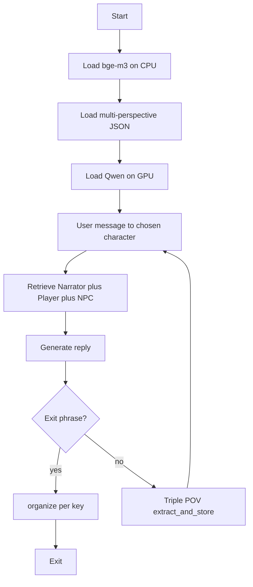

# Good Night AI — agent context

Use this document when continuing work on this repo. Prefer small, focused changes. Do not invent FastAPI/RAG layers unless asked. Model weights live under `models/` (gitignored) or `MIA_MODELS_DIR`. The Python venv is `.venv` at the repo root.

Active feature branch for text-game work: **`AI_text_game`**.

## What this project is

A local chat with **Mia**. One NVIDIA GPU runs Qwen (7B 4-bit or 14B GGUF). Long-term memory is **multi-perspective**: a JSON dict of character/role keys to string lists. On each user-initiated turn, an importance gate runs once; if important, three POV rewriters fill **Narrator** (objective), **Player** (user POV), and the **interlocutor** (e.g. Mia). **bge-m3** (CPU) retrieves from those three buckets into the reply prompt. After good night, Mia replies once, then organize cleans each key that had session-new strings.

## External dependencies (not committed)

| Asset | Default path | Device |
|-------|--------------|--------|
| Chat model `Qwen2.5-7B-Instruct-bnb-4bit` | `models/Qwen2.5-7B-Instruct-bnb-4bit` | GPU (`device_map="auto"`) |
| Chat model 14B GGUF | `models/Qwen2.5-14B-Instruct-GGUF/Qwen2.5-14B-Instruct-Q4_K_M.gguf` | GPU + RAM |
| Retriever `BAAI/bge-m3` | `models/bge-m3` | CPU |
| llama-cpp CUDA 12 DLLs | `models/llama_cpp_cudart12` | — |
| Python env | `.venv` | — |

Override the models root with env `MIA_MODELS_DIR` (same folder layout as `models/`).

Packages: `torch` (CUDA), `transformers`, `accelerate`, `bitsandbytes`, `sentence-transformers`, `huggingface_hub`, `fastapi`, `uvicorn`, `llama-cpp-python`.

Run: double-click `run_mia.bat` / `run_web.bat`, or with venv active: `python -m mia_chat.chat_cli`.

---

## File map

### `run_mia.bat`

Launcher. `cd`s to the repo root, puts `models\llama_cpp_cudart12` on `PATH`, and runs `.venv\Scripts\python.exe -m mia_chat.chat_cli`. If the script errors, `pause` keeps the window open.

### `README.md`

Human setup guide: hardware, pip install, model paths, how to run. Keep in sync when paths or packages change.

### `AGENT_CONTEXT.md`

This file. Orientation for agents / future you.

### `mia_chat/__init__.py`

Marks `mia_chat` as a package. Nearly empty.

### `mia_chat/chat_cli.py`

Thin CLI over `MiaEngine`.

### `mia_chat/engine.py`

Shared engine for CLI and FastAPI. Loads Qwen + bge-m3. `active_character` defaults to `Mia`. Each chat turn:

1. `retrieve_for_turn` from Narrator + Player + active character.
2. Build system prompt = Mia persona + labeled recalled memories.
3. Generate reply; log transcript.
4. Exit phrase → `organize_memory`, rebuild retriever, end.
5. Else → `extract_and_store(..., character=active)` (triple write).

### `mia_chat/memory.py`

**All long-term memory logic.**

| Symbol | Role |
|--------|------|
| `NARRATOR_KEY` / `PLAYER_KEY` | Fixed keys `"Narrator"` / `"Player"` |
| `SPEAKABLE_CHARACTERS` / `DEFAULT_CHARACTER` | NPC roster; starts with `"Mia"` |
| `MEMORY_PATH` | `mia_chat/data/long_term_memory.json` |
| `SESSION_NEW_KEY` | In-RAM `_session_new`; stripped on save |
| `load_memory` / `save_memory` / `public_memory_store` | JSON I/O; legacy `facts` → Narrator texts |
| `MemoryRetriever` | Index all string memories; `retrieve`, `retrieve_for_turn`, `best_match` |
| `extract_and_store` | One gate → three POV rewrites → append strings |
| `organize_memory` | Per-key same/contradict cleanup; keep earlier list entry |
| `format_facts_for_prompt` | Labeled `【Narrator】` / `【Player】` / `【Mia】` blocks |

**Storage shape:**

```json
{
  "Narrator": ["objective fact…"],
  "Player": ["from my point of view…"],
  "Mia": ["from Mia's point of view…"]
}
```

Values are plain strings only (no certainty / UUID / timestamps on disk).

**User-initiated turn write path:**

1. Gate: important? If no → stop all three.
2. Rewrite Narrator (objective), Player (user POV), interlocutor (NPC POV).
3. For each string: exact or near-dup within that key → skip; else append and mark session-new.

**Recall path:** merge top hits from Narrator + Player + active character into the system prompt.

**Organize (after goodbye):** for each key with session-new texts, compare vs peers in that key; `same`/`contradict` → drop the later list entry; clear session-new; save.

### `mia_chat/api.py`

- `GET /api/health` — includes `facts_count`, `characters`, `active_character`
- `GET /api/memory` — full character→string[] dict
- `GET /api/characters` — speakable roster + active
- `POST /api/chat` — body `{ message, character? }`

### `mia_chat/chat_log.py`

Append-only user transcript (`mia_chat/data/chat_log.jsonl`). Not used for retrieval or facts. Gitignored.

### `mia_chat/_download_bge_m3.py`

One-shot download of `BAAI/bge-m3` into `models/bge-m3` (or `MIA_MODELS_DIR`).

---

## Runtime flow



---

## Rules for agents editing this project

1. Keep large weights under `models/` (gitignored) or `MIA_MODELS_DIR`; do not commit them.
2. Keep **chat on GPU**, **bge-m3 on CPU** unless the user asks otherwise.
3. Short-term chat history stays in RAM only; do not log full transcripts unless asked.
4. Exit phrases: Mia speaks first, **then** organize — never organize before the last reply.
5. User-initiated turns write **exactly three** buckets: Narrator, Player, interlocutor.
6. Prefer extending `memory.py` for memory features; keep `engine.py` as the thin orchestrator.
7. JSON dict-of-lists is enough; do not migrate to SQLite unless requested.
8. Do not reintroduce per-fact certainty objects unless the user asks.
9. Match existing style: Chinese prompts for Mia/gates, English comments OK.
10. Character-picker UI and NPC-initiated convos are deferred unless requested.

## Quick test checklist

- Start chat; trivial hi → `[memory] not important` or no save.
- Assert a preference → Narrator, Player, and Mia each may gain string(s); UI groups by key.
- Contradict a recalled fact → Mia shows mild confusion when relevant memories are injected.
- Say `晚安` → Mia replies → `[organize]…` → same/contradict cleaned within each key.
