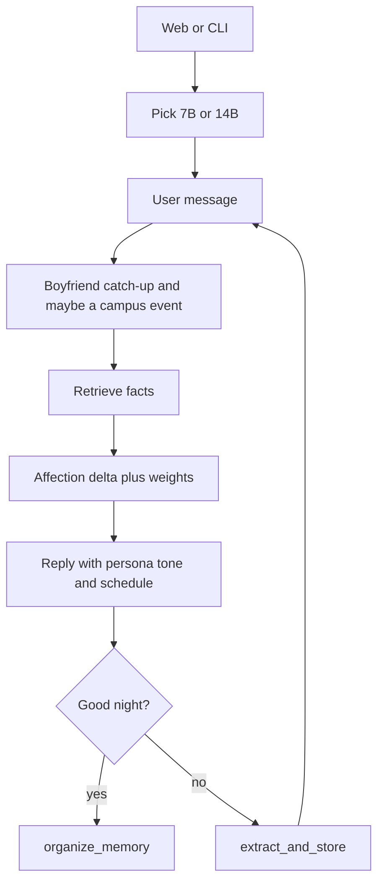

# Good Night AI — agent context

Use this document when continuing work on this repo. Prefer small, focused changes. Do not invent extra services unless asked. Models and the Python venv live **outside** this folder.

Current branch for the dating sim is **Rizz-the-AI**. `master` is the earlier girlfriend CLI.

## What this project is

A local chat with **Mia**, a cold university stranger. One NVIDIA GPU runs Qwen (7B bitsandbytes or 14B GGUF). Long-term memory is a JSON file of short facts with certainty scores. **bge-m3** (CPU) retrieves which facts to inject each turn. Affection, dating, a possible boyfriend, and a fixed campus week change how she talks.

The usual way to run it is the web UI: `run_web.bat` (API on port 8000, Vite on 5173). `run_mia.bat` still starts the CLI.

## External dependencies (not in this repo)

| Asset | Typical path on the author’s machine | Device |
|-------|--------------------------------------|--------|
| Chat model `Qwen2.5-7B-Instruct-bnb-4bit` | `C:\Users\William\William's_AI_project\Qwen2.5-7B-Instruct-bnb-4bit` | GPU (`device_map="auto"`) |
| Chat model `Qwen2.5-14B-Instruct-Q4_K_M.gguf` | `C:\Users\William\William's_AI_project\Qwen2.5-14B-Instruct-GGUF\` | GPU layers + RAM (`llama-cpp-python`) |
| CUDA 12 runtime for the GGUF wheel | `C:\Users\William\William's_AI_project\llama_cpp_cudart12` | — |
| Retriever `BAAI/bge-m3` | `C:\Users\William\William's_AI_project\bge-m3` | CPU |
| Python env | `C:\Users\William\William's_AI_project\torch_env` | — |

Packages: `torch` (CUDA), `transformers`, `accelerate`, `bitsandbytes`, `sentence-transformers`, `llama-cpp-python`, `fastapi`, `uvicorn`.

---

## File map

### Launchers

- `run_web.bat` — API window + Vite. This is the Rizz UI.
- `run_api.bat` — uvicorn `mia_chat.api:app` on `127.0.0.1:8000`. Model loads only after the UI picks 7B or 14B.
- `run_mia.bat` — CLI via `mia_chat/chat_cli.py`.

### `mia_chat/engine.py`

Shared engine for CLI and FastAPI. Loads Qwen + bge-m3 once. Short-term `history` stays in RAM and is trimmed to `MAX_PROMPT_TOKENS`.

Persona is `MIA_SYSTEM_PROMPT`: a cold campus stranger, not a girlfriend, until affection accepts a confession. Do not mention being an AI.

One chat turn, inside the engine lock:

1. Catch up the daily boyfriend roll.
2. Maybe add one campus event (at most once per local day).
3. Retrieve up to 5 facts.
4. If she is clingy (dating and affection **> 85**), apply an absence penalty from waking hours since the last user line.
5. Ask the model for an affection delta, then apply parabolic weight, streak, and the user speed.
6. A raw delta **≤ −8** stores one hurt fact.
7. If blocked (affection hit 0), log the user line and do not reply.
8. Otherwise judge confession / breakup, build the system prompt (persona + affection tone + schedule + recalled facts), generate, log.
9. Exit phrases (`good night`, `night night`, `晚安`, `exit`): she replies first, then `organize_memory`. Other turns call `extract_and_store`.

**New session** (`reset_session`) clears RAM history only. Transcript, long-term memory, and affection stay.

**重新开始** (`restart_all`) wipes the transcript, long-term facts, campus events, and relationship state. The loaded model stays. The affection **speed** slider is kept.

### `mia_chat/api.py` and `web/`

FastAPI: health, model pick, chat, history, memory, session reset, full restart, `POST /api/speed`.

The React UI (`web/src/App.jsx`) is a messenger layout: history with dates, memory panel, language, affection in the status line, and the speed slider in settings (0.8–1.5, default 1). Restart asks for confirmation before deleting anything.

### `mia_chat/affection.py`

Persisted in `mia_chat/data/affection.json` (gitignored). Starts at **20**. Hard bounds **0–100**. **0 blocks** her.

| Piece | Behavior |
|-------|----------|
| Tone bands | ≤10 cold / sarcastic, rarely asks questions; ≤40 polite stranger, rarely asks; ≤70 friend; &lt;80 close but will not accept a confession; ≥80 will accept |
| Raw delta | Normal chat about **±0.05–0.4**. Deeply moved (user cares about something that really matters to her, or a real small detail) **+1 to +5**. Fake or hollow caring is a small **minus** (−0.1 to −0.4), not a plus. Severe harm about **−8 to −15**, worst **−50** |
| Parabolic weight | Fastest change at 50, slowest near 0 and 100 (`SPEED_FLOOR` 0.15) |
| Streak | 2nd same-sign message ×1.05, up to ×1.20 at the 5th. A flat turn or a sign flip resets it. Absence does not count |
| User speed | Multiplies every signed change, including absence. Slider 0.8–1.5, default 1. Survives restart |
| Confession | Model JSON judge, not keywords. Accept at **≥ 80** sets `accepted` (dating on). Below 80 she refuses |
| Dating off | She asks to break up if affection falls **below 60**, or the judge says the user is breaking up |
| Clingy | Only while dating and affection **> 85**. More than **6 waking hours** since the last user message costs affection (0.35 per extra hour, cap −20) and she complains. Local **11:00 PM–7:00 AM** is not counted |
| Boyfriend | Once per new local day, if she is not the user’s girlfriend, roll **1%** per missed day. First open only records `last_access_day`. If it hits, `has_boyfriend` stays on: emotional distance, affection **caps at 60**, mildly intimate lines get “I have a boyfriend”, confessions are refused |
| Hurt memory | Raw delta ≤ −8 writes one long-term grudge fact (`store_hurt_fact`) |

### `mia_chat/schedule.py`

Fixed local weekly timetable, plus occasional one-off events in `mia_chat/data/campus_life.json` (gitignored). Events are also inserted into long-term memory (`source: campus`) so retrieval can bring them back. She only brings campus life up on her own when affection is **above 40**. Below that she answers “what are you doing” from the timetable and does not volunteer it.

### `mia_chat/memory.py`

Long-term facts. Unchanged idea: gate → rewrite up to 5 facts → certainty → bump near-duplicates. Organize on good night compares `session_new` facts (`same` / `contradict` / `unrelated`). Nicknames and likes that can coexist stay `unrelated`.

New-fact certainty is approximately `0.06 + 0.28*intro + 0.22*context` (about 0.05–0.55).

Facts may be about the user **or** Mia’s own campus life and fights. `format_facts_for_prompt` says so.

### `mia_chat/chat_log.py`

Append-only transcript `mia_chat/data/chat_log.jsonl` (gitignored). The UI loads it. It is **not** model context. It **is** the clock for clingy absence: `hours_since_last_user_message` counts waking hours only.

---

## Runtime flow

---

## Rules for agents editing this project

1. Do not put model weights inside this repo; only update path constants.
2. Keep chat on the GPU and bge-m3 on the CPU unless the user asks otherwise.
3. Short-term history stays in RAM. The JSONL transcript is for the human and for absence timing.
4. On good night, Mia speaks first, then organize. Do not organize before that reply.
5. One user turn → one importance gate → up to 5 facts. Do not merge sibling facts from the same turn.
6. Affection tone lives in `affection_prompt_block`. Do not bake relationship stages into `MIA_SYSTEM_PROMPT`.
7. Dating is only the `accepted` flag. A boyfriend is a separate flag and blocks a new confession.
8. Personal runtime files stay gitignored: chat log, long-term memory, affection, campus life.
9. Match existing style: Chinese prompts for Mia and the judges, English comments are fine.
