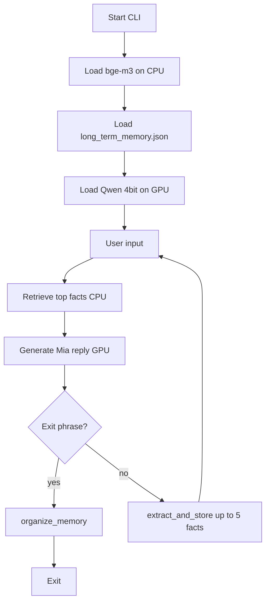

# Good Night AI — agent context

Use this document when continuing work on this repo. Prefer small, focused changes. Do not invent FastAPI/RAG layers unless asked. Models and the Python venv live **outside** this folder.

## What this project is

A local CLI girlfriend chat named **Mia**. One NVIDIA GPU runs a 4-bit Qwen chat model. Long-term memory is a JSON file of short facts with certainty scores. An embedding model (**bge-m3**, CPU) retrieves which facts to inject each turn. After the user says good night, Mia replies once, then a consolidation pass cleans the JSON.

## External dependencies (not in this repo)

| Asset | Typical path on the author’s machine | Device |
|-------|--------------------------------------|--------|
| Chat model `Qwen2.5-7B-Instruct-bnb-4bit` | `C:\Users\William\William's_AI_project\Qwen2.5-7B-Instruct-bnb-4bit` | GPU (`device_map="auto"`) |
| Retriever `BAAI/bge-m3` | `C:\Users\William\William's_AI_project\bge-m3` | CPU |
| Python env | `C:\Users\William\William's_AI_project\torch_env` | — |

Packages: `torch` (CUDA), `transformers`, `accelerate`, `bitsandbytes`, `sentence-transformers`, `huggingface_hub`.

Run: double-click `run_mia.bat`, or with venv active: `python mia_chat\chat_cli.py`.

---

## File map

### `run_mia.bat`

Launcher. `cd`s to the repo root and runs `torch_env\Scripts\python.exe mia_chat\chat_cli.py`. On another machine, edit the Python path. If the script errors, `pause` keeps the window open.

### `README.md`

Human setup guide: hardware, pip install, model paths, how to run. Keep in sync when paths or packages change.

### `AGENT_CONTEXT.md`

This file. Orientation for agents / future you.

### `mia_chat/__init__.py`

Marks `mia_chat` as a package. Nearly empty.

### `mia_chat/chat_cli.py`

**Main entrypoint.** Responsibilities:

- Load Qwen 4-bit once (`MODEL_ID`).
- Load `MemoryRetriever` (bge-m3 on CPU) and `long_term_memory.json`.
- Interactive stdin loop.
- **Short-term memory:** in-RAM `history` list of `{role, content}`; forgotten when the process exits. Trimmed by `trim_history_to_budget` for the prompt token cap (`MAX_PROMPT_TOKENS`).
- Each turn:
  1. Retrieve top facts for the user text (`MemoryRetriever.retrieve`).
  2. Build system prompt = Mia persona + only those recalled facts.
  3. Generate Mia’s reply on GPU.
  4. If user text is an exit phrase (`good night`, `night night`, `晚安`, `exit`): print Mia’s reply, then call `organize_memory`, rebuild retriever, exit. **Do not** run `extract_and_store` on the goodbye turn.
  5. Otherwise call `extract_and_store(...)` with `recalled_hits` for certainty context.
- Persona: `MIA_SYSTEM_PROMPT` (Chinese girlfriend persona; gentle confusion if user contradicts recalled memory).

When editing chat behavior, start here. When editing memory logic, edit `memory.py` and only wire from here.

### `mia_chat/memory.py`

**All long-term memory logic.** Key pieces:

| Symbol | Role |
|--------|------|
| `MEMORY_PATH` | `mia_chat/data/long_term_memory.json` |
| `EMBED_MODEL_ID` / `EMBED_DEVICE` | bge-m3 path; keep `"cpu"` so VRAM stays with Qwen |
| `RETRIEVE_TOP_K` / `RETRIEVE_MIN_SCORE` | Recall up to 5 facts if score ≥ 0.25 |
| `MAX_FACTS_PER_TURN` | Extract at most 5 facts from one user turn |
| `NEAR_DUP_MIN` | Embedding threshold to bump existing fact instead of insert |
| `MemoryRetriever` | Encode/index facts; `retrieve`, `best_match`, `rebuild`, `add_fact_embedding` |
| `load_memory` / `save_memory` | JSON I/O; missing fields normalized (`certainty`, `session_new`, `updated_at`) |
| `format_facts_for_prompt` | Bullet list for system prompt (includes certainty) |
| `is_important` | Qwen gate: worth remembering? |
| `summarize_facts` | Qwen rewrite → `{"facts": ["...", ...]}` (one idea per string) |
| `score_introduction` / `score_context_match` / `compute_certainty` | Certainty for new facts |
| `bump_certainty` | User re-hints same fact → raise certainty |
| `extract_and_store` | Full pipeline for one non-exit turn |
| `organize_memory` | Post–good-night consolidation |

**Extraction pipeline (one user turn = one `input()`, not “one line of text”):**

1. Gate: important? If no → stop.
2. Rewrite: up to 5 **independent** atomic facts (not split by newlines).
3. For each fact separately: exact-string match or very-high embedding match → bump; else insert with certainty. Sibling facts from the **same turn** must not merge into each other (`skip_ids`).

**Certainty (new facts start relatively low):**

`certainty ≈ 0.12 + 0.40 * intro + 0.35 * context` (clamped ~0.05–0.85).  
`intro` = how assertively the user stated it (Qwen).  
`context` = similarity of the fact to this turn’s recalled long-term hits (embeddings).

**Organize (after Mia’s last goodbye message):**

- Only facts with `session_new: true` vs other facts.
- Embedding candidates, then Qwen classifies `same` | `contradict` | `unrelated`.
- `same` or `contradict`: keep higher certainty, delete the other. Preferable preferences that can both be true → `unrelated` (e.g. likes blue and likes yellow).
- Clear all `session_new` flags; save JSON; caller rebuilds retriever.

Qwen helper calls use greedy `generate` + strict JSON prompts (`GATE_SYSTEM`, `REWRITE_SYSTEM`, `INTRO_SYSTEM`, `ORGANIZE_SYSTEM`).

### `mia_chat/data/long_term_memory.json`

Persistent long-term store. Shape:

```json
{
  "facts": [
    {
      "id": "uuid",
      "text": "short factual sentence",
      "certainty": 0.0,
      "created_at": "ISO-8601",
      "updated_at": "ISO-8601",
      "source": "chat",
      "session_new": false
    }
  ]
}
```

Deleting a fact = remove its object from `facts` and save (or let `organize_memory` drop it). Empty `facts: []` is valid (fresh start).

### `mia_chat/_download_bge_m3.py`

One-shot Hugging Face download of `BAAI/bge-m3` into `EMBED_MODEL_ID`’s folder. Not needed at runtime once weights exist.

---

## Runtime flow (mermaid)



---

## Rules for agents editing this project

1. **Do not** put large model weights inside `Good_night_AI`; only update path constants.
2. Keep **chat on GPU**, **bge-m3 on CPU** unless the user asks otherwise.
3. Short-term chat history stays in RAM only; do not log full transcripts unless asked.
4. Exit phrases: Mia speaks first, **then** organize — never organize before the last reply.
5. One user turn → one importance gate → many facts (max 5); facts are semantic units, not text lines.
6. Prefer extending `memory.py` for memory features; keep `chat_cli.py` as the thin loop.
7. JSON is enough for now; do not migrate to SQLite unless requested.
8. Match existing style: Chinese prompts for Mia/gates, English comments OK.

## Quick test checklist

- Start chat; trivial hi → `[memory] not important` or no save.
- “我叫X，住在Y” → `[memory] extracted 2 separate fact(s)` and two JSON rows with `certainty` / `session_new: true`.
- Contradict a recalled fact → Mia shows mild confusion.
- Say `晚安` → Mia replies → `[organize]…` → duplicates/contradictions with lower certainty removed.
